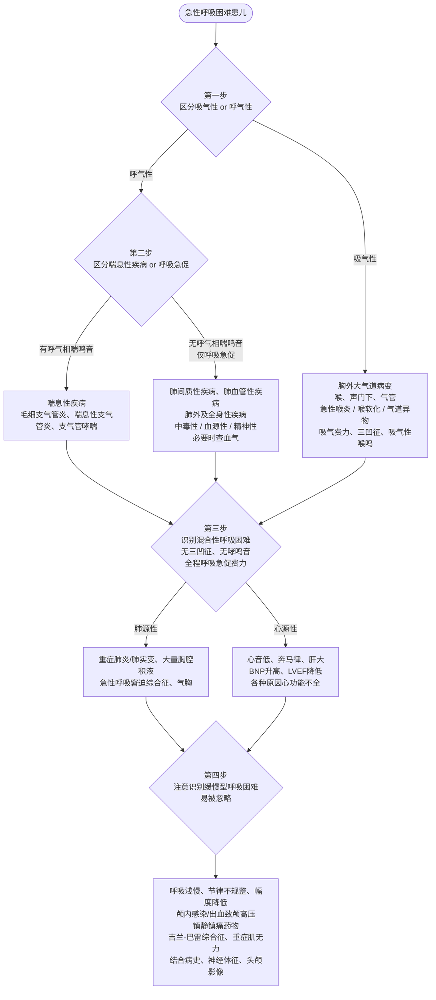

# 儿童急性呼吸困难的诊疗思路

> **文献出处**：朱昱瑶，付红敏. 儿童急性呼吸困难的诊疗思路［J］. 中国实用儿科杂志，2026，41（9）：729-732.
> DOI：10.19538/j.ek2026090604
> **作者单位**：昆明医科大学附属儿童医院（昆明市儿童医院）呼吸与危重症医学科
> **通信作者**：付红敏（fuhongmin@kmmu.edu.cn）
> 收稿 2026-06-11；修回 2026-07-23

---

## 一、核心要点速览

- 呼吸困难（dyspnea）是儿童急诊最常见的就诊原因之一，**病情急、进展快**，识别不及时可迅速进展为呼吸衰竭甚至心跳骤停。
- 儿童（尤其婴幼儿）**气道管径细、气道阻力高、呼吸功能储备低、氧代谢需求高**，故肺内外疾病均易致呼吸困难。
- 本文从 **6 个方面**构建诊疗思路：定义与分类 → 病理生理机制 → 各病因临床表现 → 分度与评估 → 病因诊断四步法 → 治疗原则；并首次提出"**呼吸障碍**"（快速型 / 缓慢型）概念。
- 核心原则：**先救命、后治病**；**ABCDE 快速评估**；**四步病因定位**。
- 最易被漏诊的是"**慢、浅、弱**"型呼吸困难（缓慢型呼吸障碍）。

---

## 二、定义及分类

### 2.1 定义

呼吸困难指患者**自觉空气不足、呼吸费力或窒息**等呼吸不适的**主观体验**，伴或不伴呼吸费力的**客观表现**：

- 张口呼吸、点头呼吸、呻吟、鼻翼扇动、**三凹征**
- 可伴呼吸**频率、深度与节律**改变

**关键提示**：呼吸困难既是**症状**也是**体征**。婴幼儿因年龄、语言及社会心理因素**不能准确描述**，主要依靠**客观体征**判断。

### 2.2 分类（三种分类维度）

| 分类依据 | 类型 | 说明 |
|---|---|---|
| 按病程 | 急性呼吸困难 | 病程 **3 周以内** |
| 按病程 | 慢性呼吸困难 | 持续 **3 周以上** |
| 按病因 | 肺源性 | 气道、肺实质、胸膜病变 |
| 按病因 | 心源性 | 左心功能不全致肺淤血 |
| 按病因 | 中毒性 | 代谢性酸中毒、药物/毒物 |
| 按病因 | 血源性 | 血红蛋白量与质异常 |
| 按病因 | 神经精神性 | 中枢病变、癔症/焦虑 |
| 按发生时相 | 吸气性 | 胸外大气道（喉、声门下、气管） |
| 按发生时相 | 呼气性 | 胸内小气道（支气管、细支气管） |
| 按发生时相 | 混合性 | 肺实质/胸膜/心源性 |

> **小儿特点**：多为急性起病，进展快，可迅速危及生命，需**紧急明确病因并处理**。

---

## 三、病理生理机制

### 3.1 正常呼吸动作——一个经典神经反射弧

**推论**：凡导致 ①感受器内环境变化 ②气道不畅 ③中枢及神经肌肉异常 的因素，均可引起呼吸困难。

### 3.2 四类致呼吸困难机制

| 机制 | 触发因素 | 生理过程 | 临床对应 |
|---|---|---|---|
| ① **缺氧及高碳酸血症** | 各种肺内外疾病 | 刺激颈动脉体、主动脉弓、中枢化学感受器 → 反射性兴奋呼吸中枢 → 呼吸加深加快；CO₂ 迅速透过血脑屏障，在脑脊液生成 H⁺ 刺激中枢感受器（**最重要的化学调节因素**）；肺淤血、炎症、间质水肿、间质性肺病刺激**肺牵张感受器** | 呼吸急促、呼吸困难 |
| ② **呼吸运动阻力增加** | 上呼吸道梗阻、下气道平滑肌痉挛、胸膜疾病（气胸、大量胸腔积液） | 胸壁呼吸肌内**本体感受器**激活 → 传至脑干及皮质感觉中枢信号增多 → 反射性呼吸肌做功增强 | 三凹征、辅助呼吸肌参与 |
| ③ **呼吸肌受损** | 肌炎、吉兰-巴雷综合征、重症肌无力 | 呼吸肌力减退/麻痹 → 中枢传出冲动增加 → 变为通气异常感受信号 → 经肺部迷走神经受体及呼吸肌机械感受器传入感觉运动皮层 | "空气不够用"的窒息感 |
| ④ **呼吸驱动异常** | 脑炎、颅内高压、麻醉镇静剂 | 直接损害或抑制呼吸中枢 → 呼吸节律异常 | 呼吸节律紊乱、呼吸暂停 |

---

## 四、急性呼吸困难的病因及临床表现

### 4.1 五类呼吸困难鉴别总表（重点）

| 类型 | 机制要点 | 临床表现特点 | 肺部体征/辅助检查 | 提示线索 |
|---|---|---|---|---|
| **肺源性·吸气性** | 喉、气管、大支气管病变致**中心气道狭窄与阻塞**（急性喉炎、喉软化、气道异物、外部压迫） | **吸气费力、三凹征、张口呼吸**，可伴**剧烈干咳及高调吸气性喉鸣** | — | 喉鸣、犬吠样咳 |
| **肺源性·呼气性** | 哮喘急性发作、毛细支气管炎、喘息性支气管炎 | **呼气延长及费力**，常伴**呼气相哮鸣音** | 广泛哮鸣音 | 呼气相喘鸣 |
| **肺源性·混合性** | 重症肺炎、肺水肿、气胸、大量胸腔积液、弥漫性肺间质疾病 | 吸气及呼气**均感费力**，呼吸增快 | 干湿啰音，呼吸音增强或减弱 | 全程费力 |
| **心源性** | 左心功能不全 → 肺淤血、肺泡弹性减低、弥散功能下降、肺泡张力增高刺激肺牵张感受器；肺循环压力升高反射性刺激呼吸中枢 | 呼吸急促、费力，两肺湿啰音及哮鸣音；**与肺炎/ARDS 的混合性呼吸困难难以鉴别** | 胸片心影增大；床旁超声 **LVEF 降低**、**下腔静脉塌陷 <50%**；**BNP 增高** | 精神面色差与肺部病变严重程度**不相符**；烦躁不安、拒奶、汗多；**心音低、奔马律、肝大**；强力抗感染+雾化止喘**效果不佳** |
| **中毒性** | 代谢性酸中毒、DKA、休克 → 血 H⁺ 升高、pH 降低 → 刺激外周化学感受器或直接兴奋呼吸中枢 | **深大、急促、规则的呼吸（Kussmaul 呼吸）**；中枢抑制药中毒 → 呼吸**缓慢变浅**伴节律异常；有机磷中毒 → **呼吸道大量泡沫样分泌物** + 呼吸肌无力 + 中枢驱动衰竭 | **肺部常无阳性体征** | 特殊气味、毒物接触史 |
| **血源性** | 血红蛋白**量或质**异常（严重贫血、CO/氰化物中毒、亚硝酸盐过量）→ 携氧能力下降或氧运输受阻 → 组织缺氧兴奋呼吸中枢 | **呼吸浅而快、心率增快，呼吸/心率比例正常**，常**无呼吸费力** | **肺部无阳性体征，影像无异常**；面色苍白或紫绀等血液病体征 | 贫血貌、紫绀与呼吸费力不匹配 |
| **神经精神性·中枢性** | 脑炎、脑出血、肿瘤 → 颅内压增高 → 脑干移位、缺血或受压 → 破坏呼吸节律产生与传导通路 | 呼吸节律紊乱：**潮式呼吸、抽泣样呼吸、间停呼吸** | 神经系统体征、头颅影像异常 | 意识改变、瞳孔异常 |
| **神经精神性·精神性** | 癔症、焦虑 | **呼吸快而浅，但无呼吸困难客观表现**；主诉多、症状重；过度通气致**呼吸性碱中毒** → 胸闷、口舌及肢体麻木、手足搐搦 | 肺部无阳性体征 | 情绪诱因、症状与体征分离 |

### 4.2 心源性 vs 肺源性（最难鉴别，需牢记）

| 鉴别点 | 心源性呼吸困难 | 肺源性（肺炎/ARDS） |
|---|---|---|
| 精神状态 | 精神面色差，**与肺部疾病严重度不相符** | 与病情相符 |
| 非特异性表现 | 烦躁不安、拒奶、汗多 | 发热、咳嗽、痰鸣 |
| 心脏体征 | **心音低、奔马律、肝大** | 常无 |
| 胸片 | **心影增大** | 肺实变/渗出影 |
| 床旁超声 | **LVEF 降低、下腔静脉塌陷 <50%** | 心功能正常 |
| 化验 | **BNP 增高** | 感染指标升高 |
| 治疗反应 | **强力抗感染、雾化止喘效果不佳** | 抗感染有效 |

---

## 五、分度与评估

### 5.1 呼吸困难分度

| 分度 | 临床特征 | 氧疗反应 |
|---|---|---|
| **轻度** | 仅有**呼吸频率加快**；活动、哭闹或吃奶后出现**轻度发绀** | — |
| **中度** | 呼吸**明显加快**；呼吸做功增加及**辅助呼吸肌参与**（三凹征、鼻翼扇动、点头样呼吸）；**烦躁发绀** | **吸氧后症状可改善** |
| **重度** | 呼吸困难进一步加重；**明显紫绀**、**呼吸节律不规则或呼吸暂停**；可伴**昏迷及循环功能不全** | 氧疗难以纠正，需呼吸支持 |

### 5.2 ABCDE 快速评估法

| 步骤 | 内容 | 评估要点 |
|---|---|---|
| **A** Airway 气道 | 气道是否通畅 | 有无**异物、喉鸣、喘鸣** |
| **B** Breathing 呼吸 | 呼吸功能 | **呼吸频率、呼吸做功**、异常呼吸音、异常体位 |
| **C** Circulation 循环 | 循环状态 | 心率、血压、**肤色、发绀或花纹** |
| **D** Disability 神经功能 | 意识状态 | 意识及反应，有无**烦躁、嗜睡或昏迷** |
| **E** Exposure 暴露 | 全面检查 | 询问病史、全面查体、面色、**皮疹、水肿、外伤** |

> **初步评估后必须"定位"**：上气道梗阻？下气道梗阻？肺实质/胸膜疾病？心源性？其他原因？→ 指导紧急处理优先级。

---

## 六、病因诊断思路（四步法）

> 建议对急性呼吸困难患儿按以下 4 个步骤进行病因分析（对应原文图 1）。

### 6.1 第一步：区分吸气性或呼气性

- **吸气性** → 病变在**胸外大气道**（喉、声门下、气管）
- **呼气性** → 病变在**胸内小气道**（支气管哮喘、毛细支气管炎等）

### 6.2 第二步：对呼气性呼吸困难区分喘息性疾病与呼吸急促

| 表现 | 提示 | 常见疾病 |
|---|---|---|
| **有典型哮鸣音** | 支气管痉挛或狭窄 | 毛细支气管炎、喘息性支气管炎、支气管哮喘 |
| **无哮鸣音，仅呼吸急促** | 肺间质性或血管性疾病；**警惕肺外及全身性疾病**（中毒性、血源性、精神性） | 结合病史、临床表现及**血气分析**明确 |

### 6.3 第三步：识别混合性呼吸困难

**判断标准**：既无典型吸气性三凹征、也无典型哮鸣音，呈现**全程呼吸急促、费力**。

- **肺源性**：重症肺炎肺实变、大量胸腔积液、急性呼吸窘迫综合征等
- **心源性**：各种原因引起的心功能不全（鉴别要点见第四章 4.2 表）

### 6.4 第四步：注意缓慢型呼吸困难（最易漏诊）

**判断标准**：呼吸**浅慢**、**节律不规整**、**呼吸幅度降低**，而**非**呼吸频率增快。

**提示疾病**：

- 神经系统：颅内感染/出血所致**颅内高压**
- 药物：**镇痛镇静药物**使用
- 呼吸肌/神经肌肉：**吉兰-巴雷综合征、重症肌无力**

**鉴别手段**：病史 + 神经系统体征 + 头颅影像学检查。

---

## 七、治疗原则

### 7.1 总原则

> **"先救命、后治病"** —— 先进行严重度评估，稳定生命体征，同时快速明确病因并针对病因治疗。

### 7.2 急救处理流程（中重度呼吸困难）

| 顺序 | 措施 | 要点 |
|---|---|---|
| ① | **开放气道** | 保持呼吸道通畅 |
| ② | **监护** | 心电监护 + 氧饱和度监护 |
| ③ | **循环通路** | 建立静脉通路 |
| ④ | **氧疗/呼吸支持** | 纠正低氧血症，按严重程度选择：**鼻导管 → 面罩 → 经鼻高流量氧疗（HFNC）→ 无创通气** |
| ⑤ | **有创机械通气** | 指征：**意识改变、严重低氧血症、二氧化碳进行性升高、呼吸肌疲劳**；避免持续低氧/高碳酸血症导致昏迷甚至呼吸心跳骤停 |
| ⑥ | **病因治疗** | 见 7.3 |

### 7.3 常见病因的特异性处理

| 病因 | 处理措施 |
|---|---|
| **急性喉头水肿**（如急性喉炎） | **肾上腺素 + 糖皮质激素** |
| **气道异物** | **立即支气管镜取出** |
| **大量胸腔积液** | **胸腔穿刺减压** |
| **重症肺炎** | **尽快经验性抗感染治疗** |
| **心源性呼吸困难** | **利尿、扩血管、强心** |

---

## 八、创新概念：呼吸障碍（Breathing Disorder）

### 8.1 提出背景

- 按定义，呼吸困难**既包括呼吸急促（窘迫），也包括呼吸浅慢、呼吸肌麻痹所致"空气不够用"的窒息感**。
- 成人和较大儿童可主动描述该不适；**婴幼儿不能准确表达**，需依赖客观体征。
- 临床普遍认知偏差："**呼吸困难 = 呼吸急促/窘迫**"，导致对"**慢、浅、弱**"型呼吸困难**容易忽视**。
- 因此，作者参照**心律失常分类（快速型 vs 缓慢型）**，提出"**呼吸障碍**"这一名词。

### 8.2 两型分类

| 类型 | 特征 | 主要病因 |
|---|---|---|
| **快速型呼吸障碍** | 即表现为**呼吸急促或费力**的呼吸困难 | 气道梗阻、肺炎、哮喘、心衰、酸中毒等 |
| **缓慢型呼吸障碍** | 以**呼吸频率减慢、通气不足**为特征；患儿常表现为**安静、少动、咳声低微、吸吮无力** | **神经肌肉疾病**、**电解质紊乱**、**药物因素**（麻醉手术中阿片类或镇静药物） |

### 8.3 临床意义

- 随着临床操作和新技术应用增多，**缓慢型呼吸障碍可能更加常见**。
- 提出此概念的**目的在于提醒儿科医生加强对缓慢型呼吸障碍的认识和重视**，避免遗漏而导致"原本不难挽回的严重后果"。

---

## 九、总结与临床思维提炼

1. **认识特殊性**：儿童气道细、阻力高、储备低、氧耗高 → 代偿窗窄，恶化快。
2. **把握两个"不等号"**：
   - 呼吸困难 ≠ 呼吸急促（还有"慢、浅、弱"型）
   - 呼吸困难 ≠ 肺部一定有阳性体征（中毒性、血源性、精神性可"肺清"）
3. **评估三步走**：**ABCDE 快速筛查** → **轻中重度分度** → **定位（上/下气道、肺实质/胸膜、心源性、其他）**
4. **诊断四步法**：吸气性/呼气性 → 喘息/呼吸急促 → 混合性（肺源 vs 心源）→ 警惕缓慢型。
5. **治疗双轨并行**：**稳定生命体征（气道-氧疗-通气）** 与 **病因治疗** 同步推进。
6. **警惕"治疗无效"信号**：强力抗感染+雾化止喘无效的"肺炎" → 想到**心源性**。

---

## 十、关键数字与记忆卡片

| 条目 | 关键内容 |
|---|---|
| 急性 vs 慢性分界 | **3 周** |
| 分度 | 轻、中、**重** 三度 |
| 评估方法 | **ABCDE** 五步 |
| 诊断思路 | **4 步**（吸气/呼气 → 喘息/急促 → 混合性 → 缓慢型） |
| 本文结构 | **6 个方面** + 1 个新概念 |
| 心源性超声指标 | 下腔静脉塌陷 **<50%**、**LVEF 降低** |
| 有创通气时机 | 意识改变 / 严重低氧 / CO₂ 进行性升高 / 呼吸肌疲劳 |
| 有机磷中毒特征 | 呼吸道**大量泡沫样分泌物** |
| 精神性呼吸困难特征 | 呼吸性**碱中毒**、手足搐搦 |
| 缓慢型表现 | 安静、少动、咳声低微、吸吮无力 |

---

## 十一、参考文献（原文 10 条，节选核心）

1. 呼吸困难诊断、评估与处理的专家共识组. 呼吸困难诊断、评估与处理的专家共识［J］. 中华内科杂志，2014，53（4）：337-341.
2. 陈荣昌，钟南山，刘又宁. 呼吸病学［M］. 3 版. 北京：人民卫生出版社，2022：86-93.
3. 李海潮. 呼吸困难病理生理基础与临床［J］. 中华全科医师杂志，2017，11（16）：829-832.
4. Yehya N, Smith L, Thomas NJ, et al. Definition, incidence, and epidemiology of pediatric acute respiratory distress syndrome［J］. Pediatr Crit Care Med, 2023, 24(12 Suppl 2): S87-S98.
5. Mary P, Servais L, Vialle R. Neuromuscular diseases: diagnosis and management［J］. Orthop Traumatol Surg Res, 2018, 104(1S): S89-S95.
6. 付红敏，隋铭泽. 重症肺炎低氧血症的病理生理［J］. 中国实用儿科杂志，2026，41（3）：195-197.
7. 陈伟明，陆国平. 儿童呼吸困难处理［J］. 中华实用儿科临床杂志，2018，33（18）：1366-1369.
8. Sweet DG, Carnielli VP, Greisen G, et al. European consensus guidelines on the management of respiratory distress syndrome: 2025［J］. Neonatology, 2026, 3(9): 1-26.
9. Panetti B, Bucci I, Di Ludovico A, et al. Acute respiratory failure in children: a clinical update on diagnosis［J］. Children (Basel), 2024, 11(10): 1232.
10. 陈容欣，曹佳颖，崔云. 体外膜肺氧合在儿童急性呼吸窘迫综合征中的应用［J］. 中国实用儿科杂志，2022，37（3）：181-185.
